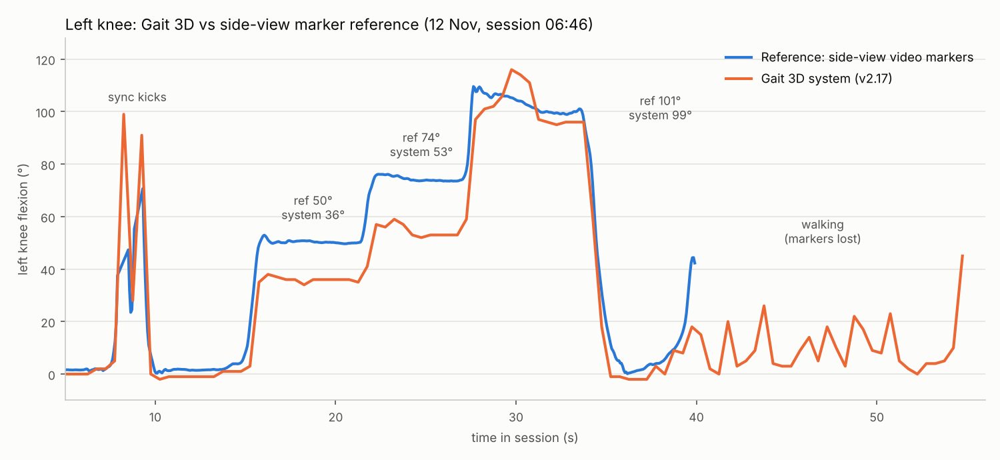
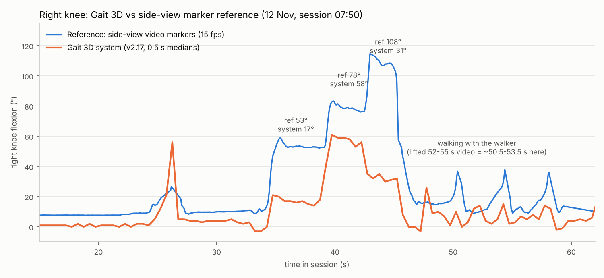

# Validation against a side-view marker reference (2026-11-12)

Method: three 2 cm white tape markers on the lateral hip (greater trochanter), lateral knee joint line and
lateral malleolus of the LEFT leg; phone video from the left side (1920x1080, 30 fps). Markers detected per
frame (`scripts/validate_markers_detect.py`, `scripts/validate_markers_track.py`), 2D knee angle from the
three points. Clocks aligned by two quick knee kicks (best offset 19.5 s, mean |diff| 9.0 deg over 79 bins).
System: v2.17, session `runs/session_20261112_064604`, left knee flexion (0-deg reference applied), 0.5 s bins
in `sys_L.txt`.

| Segment | Reference | System | Difference | System spread |
|---|---|---|---|---|
| Standing | 1.7 | -1.0 | -2.7 | 1.0 |
| Hold ~50 deg | 50.2 | 36.0 | **-14.2** | 0.7 |
| Hold ~74 deg | 73.8 | 53.0 | **-20.8** | 2.3 |
| Hold ~101 deg | 101.4 | 99.0 | -2.4 | 7.4 |
| Standing after | 1.7 | -2.0 | -3.7 | 0.4 |

Walking (10 steps with the walker, 29 half-second bins): mean difference -3.7 deg, mean |difference| 7.6 deg,
correlation 0.61. Step timing is captured, but swing peaks are **under-read by about half**: reference
~40-56 deg per step, system ~18-26 deg. (First tracker version lost the markers while walking: it only searched
the right part of the image and never re-acquired; v2 detector = white squares fully surrounded by dark fabric.)

## Right knee (session `runs/session_20261112_075046`, phone on the right, slightly behind)
Detector v3 (`validate_markers_detect.py`): the ankle tape sits at the trouser hem, so it is accepted with a
partly dark surround; every marker must be a solid square/rectangle (rejects the walker's round wheel hub, which
the tracker had locked onto first). Chosen points were checked by eye on 8 frames before use.
Clock offset video = system + 1.5 s. Note: angles.csv starts 3.75 s after keypoints.jsonl (first frame with legs).

| Segment | Reference | System | Difference |
|---|---|---|---|
| Standing | 7.8 | 1.0 | -6.8 |
| Hold 1 | 52.9 | 17.0 | **-35.9** |
| Hold 2 | 78.4 | 58.0 | **-20.4** |
| Hold 3 (foot high behind the leg) | 107.9 | 31.0 | **-76.9** |
| Walking (swing peaks per 2 s) | 18-38 | 7-26 | about half |

Keypoint probe in hold 1: confidence 0.89-1.00 in both cameras, all three joints triangulated, yet the 3D angle is
~30 deg raw (16 corrected). The error is in the depth geometry of a front view, not in detection.

